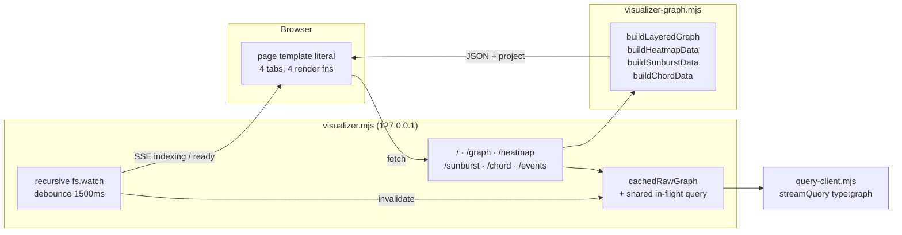

# Visualizer

The visualizer is codegraph's local browser UI: a single-file Node HTTP server (`visualizer.mjs`) that serves one hand-written HTML/CSS/JS page and four JSON endpoints, plus a pure-function module (`visualizer-graph.mjs`) that turns a raw `{symbols, edges}` graph into the geometry each view draws. Four views exist: Layered Flow, Heat Map, Sunburst, Chord.

Read this if you are changing anything the browser draws, adding or altering a view, touching the live-reload watcher, or wiring the visualizer to a different graph source. Consult it before assuming the visualizer has a router, a template engine, a build step, or a static asset pipeline — it has none of those. Graph production upstream of this subsystem is described in [parsing-and-resolution.md](parsing-and-resolution.md) and [storage-and-query.md](storage-and-query.md); the `codegraph visualize` entry point is in [mcp-and-cli.md](mcp-and-cli.md).

## Sensitive Areas

- **Duplicated source-extension list.** `visualizer.mjs:2577` inlines its own literal list for the fs watcher — `['.ts', '.tsx', '.js', '.jsx', '.mjs', '.cjs', '.mts', '.cts']` — while `source-policy.mjs:8` holds `SOURCE_EXTENSIONS = new Set(['.ts', '.tsx', '.js', '.jsx', '.mts', '.cts', '.mjs', '.cjs'])`. Two independent copies of the same list: a language added to `source-policy.mjs` is indexed but does not trigger a live-reload event until this second list is edited too. `SOURCE_EXTENSIONS` is a module-private `const`, not exported, so the copies are not currently linked by anything.
- **The browser client is one 2,455-line template literal.** `const page = \`<!doctype html>` opens at `visualizer.mjs:15` and closes at `visualizer.mjs:2471`. All client JS lives inside it, so every `\`` and `${` in the client is an escaping hazard, no client-side tooling (lint, typecheck, syntax highlighting, sourcemaps) sees it, and a syntax error inside it surfaces only in the browser console.
- **The `/` route re-reads the visualizer's own source at request time.** `visualizer.mjs:2611-2616` does `fs.readFileSync(new URL(import.meta.url).pathname)` and slices from the first `<!doctype html>` match to the first `</html>` match, falling back to the in-memory `page` constant on any failure. Adding a second literal containing either marker earlier in the file changes what is served. There is no static asset serving of any kind.
- **The client runtime has no behavioral test coverage.** `test/visualizer.test.mjs` covers `visualizer-graph.mjs`'s pure builders and `test/visualizer-e2e.test.mjs` covers the routes, SSE, and watcher, but the only assertion touching the ~1,800 lines of in-template client JS is that `/` returns HTML containing a client script (`test/visualizer-e2e.test.mjs:34`). Render, selection, filter, and pan/zoom logic are verified only by opening the page.
- **Views are hardcoded in four places that must be kept in agreement**: the tab buttons (`visualizer.mjs:548-551`), the persisted-tab allowlists (`:1136`, `:1139`, `:1150`), the per-view stats/explanation maps (`:952-980`), and the four server routes (`:2620-2687`). There is no route table, no view registry, no plugin surface.
- **Cancellation of the shared graph query.** One in-flight `streamQuery` is shared by all concurrent requests (`visualizer.mjs:2482-2516`); a waiter count guards it so a single client disconnect does not abort the query for the others — only the last waiter leaving calls `owner?.abort()`. Changing that refcount reintroduces cross-request cancellation.
- **Sidebar detail panes are built by string concatenation into `innerHTML`** with symbol names, file paths, and module names interpolated unescaped (e.g. `visualizer.mjs:1555-1567`, `:1730-1735`, `:2286-2290`). Content comes from the indexed codebase and the server binds to `127.0.0.1` only.

## Design Constraints

- **Fully offline.** There is zero CDN usage and zero remote fetch. The only `http://` string literals in `visualizer.mjs` are SVG XML namespace arguments to `createElementNS` (e.g. `visualizer.mjs:1262`); the only network origin in the file is `http://127.0.0.1` used as a `URL` parse base (`:2586`). No fonts, scripts, stylesheets, or images are loaded from anywhere but the page itself.
- **Loopback only.** The server listens on `127.0.0.1` (`visualizer.mjs:2696`), default port 7331 (`:13`).
- **Zero runtime dependencies and zero build step.** `visualizer.mjs` imports only `node:fs`, `node:http`, `node:path`, `./query-client.mjs`, and `./visualizer-graph.mjs` (`:2-6`). `visualizer-graph.mjs` imports nothing.
- **No SVG library.** Every arc, ribbon, and card is emitted as raw SVG path strings / `createElementNS` calls; path math lives in `describeArc` and `describeRibbon` (`visualizer-graph.mjs:612-650`).
- **Graph-shape contract with the query layer.** Builders consume exactly the `{symbols, edges}` row yielded by `streamQuery(root, { type: 'graph' })`; the last yielded row wins (`visualizer.mjs:2487-2492`).
- **Layering must stay linear.** `buildLayeredGraph` uses a Kahn-style topological longest-path pass over typed arrays, O(V+E), with an explicit unvisited-scan escape so cycles cannot hang it (`visualizer-graph.mjs:294-339`).
- **`buildChordData` symmetrizes**: it emits one chord per unordered module pair (`j` starts at `i`, `visualizer-graph.mjs:1132-1134`), so direction is carried in `sourceCalls`/`targetCalls`, not in separate chords.

## Feature Overview

The MCP and CLI surfaces answer targeted graph questions (callers of X, dead code, dependencies of Y). The visualizer answers the shape-of-the-whole-codebase questions those cannot: where the traffic concentrates, what is orphaned, and which calls run against the intended architectural direction. It exists as a local server rather than a static export because the graph is regenerated as the user edits: an fs watcher invalidates the cache and pushes an SSE event, and the page offers a one-click in-place refresh instead of forcing a reload (`visualizer.mjs:877-931`, `:2543-2557`).

The views answer complementary questions over the same validated generation:

- **Layered Flow** — per-symbol cards, split Frontend/Backend, banded by exact connection count, with callers/callees drawn on selection and upward calls flagged as violations.

Layered Flow retains the complete graph and all symbol positions while mounting only cards intersecting the SVG viewport plus 216 world units of padding. `reconcileLayeredViewport` finds candidate rows by binary search and candidate columns arithmetically; pan and zoom do not scan the complete graph to find cards. Cards removed from the viewport are released, and remounted cards restore the current filter and selected-neighbor highlights. `scheduleTransform` reconciles cards before writing the canvas transform, avoiding a viewport dimension read immediately after that transform write. Resize schedules the same update. Complete position and adjacency maps retain offscreen caller/callee navigation, and selection and violation edges preserve their complete existing output. Selected-neighbor membership is computed once per filter update, independently of mounted DOM; full-model filter changes remain separate from viewport frame work.

Root verification on the real 20,327-symbol, 31,093-edge graph retained 112 rows and mounted 66 initial cards, with 738 SVG elements instead of the prior 122,304 DOM elements. A matched 1280px viewport zoom measured layout work of 4.026ms versus the baseline 342.441ms. Browser task duration was 102.298ms versus 1,126.569ms, with tracing instrumentation enabled for the later run; these measurements establish this action's reduced work, not a universal speedup, complete page-load time or frame rate. A 300px pan mounted 60 cards; selected offscreen navigation, Most Called selection exceptions and deselection were inspected in the actual browser. Cross-view switching and return were checked, but complete Complexity population in that sequence was covered by automated tests rather than awaited in the browser. CPU profiles, traces, metrics and screenshots are retained under `profiles/layered-render-performance-2026-10-08/`.
- **Heat Map** — one 50x50 tile per file laid out in a boustrophedon (serpentine) flow, colored by normalized incoming-call density, bordered by module color.
- **Sunburst** — radial partition of the real directory tree (root → directories → file → symbol), arc width proportional to `1 + incoming calls`, with tail symbols collapsed into a `+N more` group arc.
- **Chord** — module-to-module coupling matrix as perimeter arcs plus interior ribbons, violating pairs colored red.
- **Call Tree** — a depth-bounded function call hierarchy with complexity bands and selected-function detail.

Call Tree summary cards retain their 200×48 geometry. Both text rows share a 180px clipping region, preserving full tooltip and inspector content. Keyboard focus uses an accent stroke on the card rectangle. Renderer and activation checks pass; browser checks confirm contained text, full inspector content and accent rectangle focus.
- **Complexity** — a directory/file/function treemap and histogram backed by indexed cyclomatic metrics.

Most Called and substring search apply to all six views. Most Called uses Layered Flow's distinct eligible caller/target pairs and positive in-degree threshold at `floor(positiveCount * 0.1)`, including ties. Aggregate views match containers with any ranked function. Call Tree dims cards in place; Complexity partitions its existing color paths by opacity, preserving cell coordinates and selection indices. Filters reapply after rendering. Orphans and violations retain their existing support in the original four views. Include Tests re-fetches with `?includeTests=1`.

Call Tree and Complexity obtain ranking from the existing raw graph cache after their summary queries. A cold summary-only load now also loads the graph; filter clicks make no requests. Complexity keeps its metrics-only summary query. Root browser checks on a three-function fixture confirmed all six tabs, retained filters, search intersection, All restoration and selection of a dimmed Complexity cell. These checks do not establish large-repository performance.

Complexity selection uses one unfilled accent rectangle over the pinned cell. The rectangle is a child of the transformed canvas and a sibling of the batched grid, with pointer events disabled and a non-scaling 2px stroke. Selection through click, keyboard or inspector navigation updates its coordinates; filtering preserves it and rendering clears it. Detail loading or failure leaves the marker visible. Root browser checks confirmed movement between cells, persistence after filtering, unchanged hit bounds and alignment after zoom. The visualizer process must restart to load changes to its embedded client code; page reload alone retains code from the running process.

The selected-owner inspector requests `internals` operation `details`: one compact record containing loop count, call occurrence count and unique target IDs in encounter order. Existing summary metrics, generation, target navigation and Back remain intact. It no longer requests a combined syntax/CFG map or raises the 2,000-record limit. Partition validation and owner-filtered iterators still inspect the selected file; this does not establish owner-only CPU work. Focused regressions pass, and an independent query of the indexed `Plot.tsx` owner that previously exceeded the map limit returns exactly 44 call occurrences and 31 unique targets.

Editorial semantics are deliberately codegraph-specific rather than generic graph drawing: `isTestFile` and `classifyArchitecturalTier` (`visualizer-graph.mjs:65-241`) encode this project's opinion about what a test file is and which tier a path belongs to, and `filterSymbols` (`:79-116`) drops types/interfaces/enums, destructuring artifacts, `SCREAMING_CASE` constants, and (by default) test files so the views show callable code only.

## Architecture

Two files, a clean split:

**`visualizer-graph.mjs` — pure builders, no I/O, no DOM.** Color utilities (`COLOR_PALETTE`, a precomputed 360-entry HSV table, `colorFor`, `heatColorFor`, `hslToHex`, `getContrastText`), classification (`isTestFile`, `filterSymbols`, `classifyRegion`, `classifyArchitecturalTier`, `moduleOf`), SVG path math (`describeArc`, `describeRibbon`), and the four view builders. Every builder takes `(rawGraph, options)` and returns plain JSON-serializable data — the same functions the unit tests call directly.

**`visualizer.mjs` — the shell.** Four parts:

1. *Arg parsing* (`:8-13`): `--root` / `--port` / a positional path, falling back to `CODEGRAPH_ROOT` then `process.cwd()`.
2. *The `page` template literal* (`:15-2471`): CSS, static markup, and the entire client runtime.
3. *`createVisualizerServer(rootPath, options)`* (`:2473-2693`): the graph cache and shared-query refcount, the fs watcher and SSE broadcast, and the request handler.
4. *The main guard*: compares the executable path with `fileURLToPath(import.meta.url)` and listens only when run as the entry module. Node's URL conversion handles Windows drive paths and decoded spaces or escaped characters; importing the module does not listen.

Server-side request flow: `graphForRequest(req, res)` (`:2520-2526`) creates an `AbortController` wired to `req 'aborted'` and `res 'close'`, then calls `fetchRawGraph(false, signal)`; that returns the cached graph, or joins the single in-flight `streamQuery`, incrementing a waiter count so only the last departing waiter aborts it. The route then calls its builder, stamps `project = { name: path.basename(rootPath), root: rootPath }` onto the result, and serializes it.

Routes, in order, each a bare `if (parsedUrl.pathname === …)` with a copy-pasted `try`/`catch` that logs and returns HTTP 500 `{error}`:

| Path | Builder | Options |
|---|---|---|
| `/events` | — | SSE, 25 s keepalive ping (`:2587-2607`) |
| `/` | — | serves sliced own source, else `page` (`:2608-2619`) |
| `/graph` | `buildLayeredGraph` | `{includeTests}` (`:2620-2636`) |
| `/heatmap` | `buildHeatmapData` | `{includeTests, width: 1400}` (`:2637-2653`) |
| `/sunburst` | `buildSunburstData` | `{includeTests, cx: 500, cy: 500, radius: 440}` (`:2654-2670`) |
| `/chord` | `buildChordData` | `{includeTests, cx: 500, cy: 500, radius: 360}` (`:2671-2687`) |

Anything else falls through to `res.statusCode = 404; res.end('not found')` (`:2688-2689`).

Live reload: one recursive `fs.watch` on the resolved root (`:2572-2579`) — chosen over several narrow watches so a single fd covers both source files and `.codegraph/CURRENT`. `isIgnoredWatchPath` (`:2559-2566`) drops `node_modules`, `.git`, `dist`, `build`, `coverage`, `.codegraph/{generations,partitions,overlays}`, `*.tmp`, and `query-view-cache.bin`. A surviving event for `CURRENT` or a source extension enters `handleFileChange`, which broadcasts `{status:'indexing'}` once, then after `debounceMs` (default 1500, overridable via `options.debounceMs`) nulls `cachedRawGraph` and broadcasts `{status:'ready'}`. A watcher that fails to attach is caught and logged; the server still serves.

The `/calltree` and `/complexity` routes read generation-pinned internal summaries through the same query client as the existing views. Detailed CFG records load only for the selected function.

Client architecture: module-scope state (`currentView`, one cache variable per view, `transform`, selection ids), pan/zoom via a single `transform` attribute on `#canvas` written inside a `requestAnimationFrame` (`scheduleTransform`, `:686-694`), and `switchView()` (`:933-1000`) as the single dispatcher — it toggles the four stats rows, swaps the explanation text, and lazily loads the active view, clearing all four caches when `forceFresh`. `fetchViewData` (`:1003-1021`) dedupes concurrent fetches by URL. Active-tab state persists in `localStorage` under `codegraph_active_tab` and in `location.hash`, with a `hashchange` listener (`:1134-1158`). Each view keeps its own render function, selection state, and `applyFilter` branch (`:2302-2466`); there is no shared render abstraction.

## Functions

**`visualizer-graph.mjs`**

- `colorFor(index)` / `COLOR_PALETTE` — O(1) lookup into a precomputed 360-entry HSV table (sat 0.72, val 0.85); hue stride is the prime 47, so adjacent indices are visually distinct and no entry is pure black or white.
- `heatColorFor(heatRatio)` — 0 → `#1e293b`; otherwise gamma 0.75 on the ratio, hue 200 → 5, saturation and value rising with heat.
- `getContrastText(hex)` — luminance > 135 → `#090d16`, else `#f8fafc`.
- `formatLocation(file, line)` — `basename:line`.
- `isTestFile(path)` — true on `.test.`, `.spec.`, a leading or embedded `test/`, or a leading or embedded `__tests__/` (case-insensitive).
- `filterSymbols(symbols, {includeTests})` — drops non-string/nameless symbols, kinds in `{enum, interface, type}`, names containing `{`/`}`/`[]` or starting with `[`/`Object[`/`Array[`, names matching `/^[A-Z0-9_]{2,}$/`, and test-file symbols unless `includeTests`.
- `classifyRegion(file, name)` — binary `frontend` / `backend`, defaulting to `backend`.
- `classifyArchitecturalTier(file, name)` — six tiers, first match wins; see Models.
- `moduleOf(path)` — parent directory, or `"root"` for a top-level file.
- `describeArc(cx, cy, r0, r1, a0, a1)` — annulus-segment path (or a pie wedge when `r0 <= 0.001`); a full circle is shortened by 0.0001 rad so it renders.
- `describeRibbon(cx, cy, r, sa0, sa1, ta0, ta1)` — two arcs joined by quadratic curves through the center.
- `hslToHex(h, s, l)` — used only by the sunburst palette.
- `buildLayeredGraph(rawGraph, options)` — filters, indexes ids to array slots, dedupes edges by `u * 1000000 + v`, runs the linear topological longest-path layering, computes in/out degree, derives a top-10% in-degree threshold for `isMostCalled`, and marks `isViolation` on any edge whose target layer is `<=` its source layer.
- `buildHeatmapData(rawGraph, options)` — per-symbol degrees, aggregation into files then directory modules, alphabetical sort of modules and files with symbols sorted by line, heat normalized against the max file in-call count, `isMostCalled` when any contained symbol meets the shared Layered ranking, tier-violation sets, and the serpentine 50 px/5 px-gap layout (`targetCols = clamp(8, 50, ceil(sqrt(files) * 1.3))`, overridable via `options.maxCols`).
- `buildSunburstData(rawGraph, options)` — builds a real recursive directory tree, computes bottom-up `value`/`calls` and max depth, sizes rings as `clamp(28, 80, (radius - 70) / maxDepth)`, assigns a top-level theme palette per branch with lightness stepping inward, and lays out arcs recursively; symbol arcs thinner than 0.0008 rad beyond index 10 collapse into one `type: "group"` arc.
- `buildChordData(rawGraph, options)` — module-by-module `Float64Array` call matrix, per-module flow `= max(1, row + column)`, angular spans proportional to flow with padding `min(0.04, (π/4)/modCount)`, one chord per unordered pair, `isViolation` when a directional call runs from a higher tier ordinal to a lower one; violating chords are `#ef4444` and mark both endpoint modules `hasViolation`.

**`visualizer.mjs`**

- `createVisualizerServer(rootPath = root, options = {})` — the only export. `options.streamQuery` overrides the query source (this is what the E2E tests inject); `options.debounceMs` overrides the 1500 ms debounce. Returns the `http.Server` with the `fs.watch` handle attached as `server.watcher`.
- `fetchRawGraph(forceFresh, signal)` / `graphForRequest(req, res)` — the shared, refcounted, cancellable graph fetch described in Architecture.
- `handleFileChange(eventType, filepath)` / `isIgnoredWatchPath(candidate)` / `broadcast(data)` — the watcher and SSE side.

Client functions of note: `switchView(forceFresh)`, `fetchViewData(url)`, `loadGraph`/`loadHeatmap`/`loadSunburst`/`loadChord`, `renderGraph`/`renderHeatmap`/`renderSunburst`/`renderChord`, `selectNode`/`selectHeatmapFile`/`selectHeatmapModule`/`selectSunburstNode`/`selectChordModule`, `createEdgePathElement(e)` (edges are created only on selection or under the violations filter, never eagerly), `centerView(viewName)` (per-view fit-to-viewport math), `focusNode`/`animatePanTo` (280 ms eased pan), `applyFilter()`, and `window.applyPendingUpdate`/`window.dismissToast`. `getContrastText` and `describeArc` are re-declared inside the client (`:1580-1588`, `:1821-1837`) rather than shared with the module — the module's copies never reach the browser.

## Models

**Input — the raw graph row** consumed by all four builders, as yielded by `streamQuery(root, { type: 'graph' })`:

```
{
  symbols: [ { id, name, file, line, kind? } , … ],   // kind read only by filterSymbols
  edges:   [ { from, to, … } , … ]                    // from/to are symbol ids; extra keys pass through
}
```

Non-array `symbols`/`edges` degrade to `[]`; edges naming unknown symbols are dropped.

**`classifyArchitecturalTier` tiers** — exactly six values, evaluated in this order, first match wins:

| Tier | Matched by |
|---|---|
| `hook` | `/^use[A-Z0-9_]/` names, names ending `hook`/`context`, `/hooks/`, `/context/`, `/contexts/`, `/client/hooks`, `/stores/`, `*.hook.ts`, `*.hook.js` |
| `ui` | `.tsx`/`.jsx`/`.vue`/`.svelte`, `/components/`, `/pages/`, `/views/`, `/ui/`, `/screens/`, `/layouts/`, `/frontend/`, `/client/components`, `/client/ui`, names ending `component`/`screen`/`view`/`page` — but reclassified `request` if the path also contains `/client/api`, `/requests/`, or `/queries/` |
| `request` | `/client/api`, `/requests/`, `/queries/`, `/mutations/`, `/fetchers/`, `*.client.ts`, names ending `query`/`mutation` or starting `fetch` |
| `api` | `/routes/`, `/controllers/`, `/api/`, `/handlers/`, `/endpoints/`, `*.route.ts`, `*.controller.ts` |
| `db` | `/db/`, `/store/`, `/repository/`, `/repositories/`, `/models/`, `/prisma/`, `/schemas/`, `*.model.ts`, `*.repo.ts`, `*.repository.ts` |
| `service` | everything else, and the return value when both arguments are empty |

`TIER_LAYER_OFFSET` (`visualizer-graph.mjs:243-250`) exports `ui:0, hook:1, request:2, api:3, service:4, db:5`. Each builder additionally keeps its own local ordinal map: heatmap and sunburst use 1-based with `backend: 5` (`:397-405`, `:700-708`); chord uses 0-based with `util: 6` (`:1091`) and falls back to `3` for unmapped values.

**`buildLayeredGraph` output** — `{ nodes, edges }` (`{nodes: [], edges: []}` when nothing survives filtering). Each node is the original symbol spread plus:

```
region      "frontend" | "backend"
layer       int, longest-path topological level
tier        one of the six tiers
inDegree, outDegree, connections   ints (connections = in + out)
isOrphan    in === 0 && out === 0
isMostCalled in > 0 && in >= top-10%-of-nonzero-in-degree threshold
color       "#rrggbb"
```

Each edge is the original edge spread plus `fromLayer`, `toLayer`, `isViolation` (`toLayer <= fromLayer`). The `/graph` route adds `project: { name, root }`.

**`buildHeatmapData` output** — `{ modules, files }` (`{modules: [], files: []}` when empty), plus `project`.

```
file:   { file, symbols: [ …symbol, inDegree, outDegree ] (line-sorted),
          totalInCalls, totalOutCalls, heat 0..1, color, isMostCalled, isOrphan,
          hasViolation, module, borderColor, x, y, width: 50, height: 50 }
module: { name, borderColor, fileCount, symbolCount, totalInCalls, files: [file, …] }
```

`modules[].files` holds the same objects as the flat `files` array. Module borders cycle a 10-color list; the flat `files` array is the render order.

**`buildSunburstData` output** — `{ nodes, maxDepth, cx, cy, radius }`, or `{ nodes: [], root: null, maxDepth: 0 }` when no symbols survive; plus `project`.

```
node: { id, name, type: "root"|"directory"|"file"|"symbol"|"group",
        depth, r0, r1, a0, a1, d (SVG path), value, calls, color,
        isMostCalled (any ranked contained symbol; false with no matches), isOrphan (calls === 0),
        hasViolation: false,
        fullPath?  (directory/file),  module?, file?, line?  (file/symbol/group),
        symbolsCount? (file) }
```

Ids are `"root"`, `"dir:<path>"`, `"file:<path>"`, the symbol's own id, and `"agg:<file>:<index>"` for group arcs. `value` for a symbol is `1 + incoming calls`; parents sum their children. `hasViolation` is computed into local sets but is written as `false` on every emitted node.

**`buildChordData` output** — `{ modules, chords, totalCalls, cx, cy, radius }`, with `modules`/`chords` empty when no modules exist; plus `project`.

```
module: { id: "mod:<name>", name, tier, a0, a1, r0: radius-28, r1: radius,
          color, totalCalls (rounded flow), isOrphan, isMostCalled, hasViolation, d }
chord:  { source, target, sourceCalls, targetCalls, calls, color, d, isViolation }
```

**Client-side models** are the same JSON plus two derived lookups: `posMap` (`id → {x, y, node}`) built during layered layout, and per-node `nameLower`/`fileLower` for search. `nodeElements`, `edgeElements`, `incomingEdgeMap`, `outgoingEdgeMap`, and `violationNodeIds` index DOM elements and adjacency for O(1) selection.

**SSE payloads** are exactly `{"status":"connected"}`, `{"status":"indexing"}`, `{"status":"ready"}`, `{"status":"ping"}`.

## Use Cases

### 1. Inspect a symbol's callers and callees in the Layered Flow view

**Goal:** A developer determines who calls a given function, what it calls, and whether any of those calls runs against the intended architectural direction.

**Stakeholders:** The developer changing the function; reviewers judging blast radius; anyone relying on the codebase's layering staying acyclic.

**Actors:** Developer (browser); the visualizer HTTP server; the query layer supplying the raw graph.

**Preconditions:** The visualizer server is running on 127.0.0.1 for an indexed root; `streamQuery(root, {type:'graph'})` yields a graph row; the browser has loaded `/`.

**Postconditions:** `graphData` is cached client-side; the clicked node's id is held in `activeSelectedId`; its caller and callee edges exist in `#edge-layer`; the sidebar shows that symbol's tier, location, layer, and adjacency lists; `cachedRawGraph` is populated server-side for subsequent requests.

**Basic Course of Events:**
1. The page initializes `currentView` from `location.hash` or `localStorage.codegraph_active_tab`, defaulting to `layered`, and calls `switchView()`.
2. `switchView` shows the layered stats row and explanation, sees `graphData === null`, and calls `loadGraph(false)`, which displays the progress overlay.
3. `loadGraph` fetches `/graph` through `fetchViewData`.
4. The server's `/graph` route reads `includeTests`, calls `graphForRequest`, which returns the cached raw graph or joins/starts the shared `streamQuery`.
5. The route calls `buildLayeredGraph(rawGraph, {includeTests})`, attaches `project`, and returns the JSON.
6. `loadGraph` stores `graphData`, fills the project pill and document title, and calls `renderGraph`.
7. `renderGraph` indexes nodes and edges, partitions them Frontend/Backend and then into bands by exact connection count, writes the six stat badges, computes `posMap`, appends one `.node-card` group per node and an empty `#edge-layer`, then calls `applyFilter`.
8. The developer clicks a card; `selectNode(node)` runs.
9. `selectNode` clears prior highlights, sets `has-selection` on the SVG (dimming unrelated cards via CSS), highlights the node and its callers and callees, and builds a caller/callee edge path for each with `createEdgePathElement` — violating edges get the dashed red `violation` class and the danger arrow marker.
10. The sidebar renders name, tier label, `file:line`, topological layer, connection counts, and clickable caller/callee lists.

**Alternate Flows:**
- The developer arrives at `#layered` or has that tab in `localStorage`; step 1 selects it without a click.
- The developer clicks a caller/callee link in the sidebar, or an edge path: `focusNode` selects the target and eased-pans it to the viewport center (an edge click with Shift held always targets the edge's `from`).
- The developer types in the search box or picks a filter; `applyFilter` hides non-matching cards, and the selected node plus its direct neighbors stay visible regardless.
- With the `violations` filter and nothing selected, `applyFilter` draws every violating edge between two visible nodes without any selection.
- Clicking the already-selected card (or the sidebar's `✕ Reset`) calls `selectNode(null)`, which clears the edge layer, drops `has-selection`, and restores the placeholder text.

**Exceptions:**
- The fetch fails or the route returns 500: `loadGraph`'s `.catch` replaces the progress message with `Error: <message>`, the overlay stays up, and no graph renders.
- No symbols survive `filterSymbols`: `buildLayeredGraph` returns empty arrays; the stats read 0 and the canvas holds only section headers.
- The developer navigates away mid-query: `graphForRequest`'s abort fires, the waiter count drops, and the underlying query is aborted only if no other request is still waiting.
- An edge references a symbol filtered out of `posMap`: `createEdgePathElement` returns `null` and that edge is skipped.

### 2. Locate call-traffic hotspots and orphan files across the codebase

**Goal:** A developer finds which files absorb the most incoming calls and which are called by nothing, without reading any code.

**Stakeholders:** Developers planning a refactor; reviewers judging where risk concentrates.

**Actors:** Developer (browser); the visualizer HTTP server.

**Preconditions:** As UC-1.

**Postconditions:** `heatmapData` is cached client-side and `currentView === "heatmap"` is persisted in `localStorage` and the URL hash; the canvas holds one tile per surviving file, fitted to the viewport; the hovered or locked file's path, module, heat percentage, and symbol list are shown in the sidebar, with `activeSelectedHeatmapFile` set when locked.

**Basic Course of Events:**
1. The developer clicks the "Heat Map" tab; the handler sets `currentView = "heatmap"`, persists it to `localStorage` and the URL hash, and calls `switchView`.
2. `switchView` swaps in the heatmap stats row and explanation and, with `heatmapData === null`, calls `loadHeatmap(includeTests)`.
3. `/heatmap` builds `buildHeatmapData(rawGraph, {includeTests, width: 1400})` off the shared raw graph and returns it with `project`.
4. `loadHeatmap` computes and writes module count, file count, total symbols, and max in-calls, then calls `renderHeatmap`.
5. `renderHeatmap` appends one 50x50 `rect` per file at the precomputed `x`/`y`, filled with the heat color and stroked with the module border color, each carrying a native SVG tooltip of path, module, calls, symbols, and heat percent.
6. `centerView("heatmap")` fits the tile bounding box to the viewport with 24 px padding and a 0.12 minimum scale.
7. The developer hovers a tile; with no locked selection, `renderHeatmapFileDetails(f, false)` highlights that tile and its module siblings and lists the file's declared symbols with per-symbol in-degree.
8. The developer clicks a tile; `window.selectHeatmapFile` locks it and re-renders the pane with the `🔍 LOCKED SELECTION` header, so subsequent hovers no longer replace it.

**Alternate Flows:**
- The developer picks the `orphans` or `most-called` filter, or types a query: `applyFilter`'s heatmap branch fades non-matching tiles to opacity 0.06.
- The developer ticks "Include Tests": `loadHeatmap(true)` re-fetches `/heatmap?includeTests=1` and re-renders with test files included.
- Clicking the locked tile again unlocks it and restores the placeholder pane.
- `selectHeatmapModule` renders a module-level pane (metrics plus contained files) for a module selection.

**Exceptions:**
- No files survive filtering: `buildHeatmapData` returns `{modules: [], files: []}`, `centerView` falls back to `{x:40, y:40, k:0.85}`, and the canvas is blank.
- Fetch or build error: the progress overlay shows `Error: <message>` and the previous view's canvas contents remain.
- Pointer leaves the tile group with a file locked: `g.onmouseleave` restores the locked file's pane rather than clearing it.

### 3. See a code edit reflected without losing the current view

**Goal:** A developer editing source keeps the visualizer current while preserving pan, zoom, and the active tab.

**Stakeholders:** The developer iterating on code; anyone demoing the graph while editing.

**Actors:** Developer (editor and browser); the recursive `fs.watch` watcher; the SSE broadcaster; the graph cache.

**Preconditions:** The server is running and the watcher attached (its startup log naming the watched root appeared); the browser holds an open `EventSource` on `/events` (the client logs the confirmed `connected` payload).

**Postconditions:** `cachedRawGraph` is `null` (or freshly repopulated by the reload); `hasPendingUpdate` is `false` and the toast is hidden; the active view holds data rebuilt from the current on-disk state, while the active tab, search text, and filter selection are unchanged (pan and zoom are re-fitted by `centerView` for the heatmap, sunburst, and chord views, and reset to the layered default for Layered Flow).

**Basic Course of Events:**
1. The developer saves a source file under the watched root.
2. The watch callback resolves the path, passes `isIgnoredWatchPath`, and matches either basename `CURRENT` or a source extension, so `handleFileChange` runs.
3. `handleFileChange`, not already debouncing, logs the change and broadcasts `{status:'indexing'}`; the client shows the `⚡ Updating...` toast.
4. Further saves within the window reset the timer without re-broadcasting `indexing`.
5. After `debounceMs`, the server nulls `cachedRawGraph`, logs the settle, and broadcasts `{status:'ready'}`.
6. The client sets `hasPendingUpdate` and shows the toast with a `⟳ Refresh` button.
7. The developer clicks Refresh; `window.applyPendingUpdate` hides the toast and calls `switchView(true)`.
8. `switchView` clears all four view caches and reloads only the active view; the server, cache now empty, runs a fresh `streamQuery` and rebuilds.

**Alternate Flows:**
- Instead of clicking Refresh the developer switches tabs: `switchView` sees `hasPendingUpdate`, promotes itself to `forceFresh`, and loads the newly-selected view fresh.
- The developer dismisses the toast with `✕`: `window.dismissToast` hides it while `hasPendingUpdate` stays set, so the next tab switch still refreshes.
- The developer ignores the toast entirely: the cache is already invalidated, so any later view load fetches fresh data.
- An edit lands only in `node_modules`, `.git`, `dist`, `build`, `coverage`, `.codegraph/{generations,partitions,overlays}`, a `.tmp` file, or `query-view-cache.bin`: `isIgnoredWatchPath` drops it and nothing is broadcast.
- A file with a non-source extension changes: the extension check drops it unless its basename is `CURRENT`.

**Exceptions:**
- `fs.watch` throws at startup: the error is caught and logged as a warning, `server.watcher` is `null`, and the server serves normally with no live updates.
- The SSE connection drops: `es.onerror` logs a warning and the browser's `EventSource` reconnects on its own; a fresh connection re-emits `connected`.
- A dead SSE client remains in the set: `broadcast` and the 25 s ping both write inside `try {} catch {}`, and `req 'close'` clears the ping interval and removes the client.
- The browser has no `EventSource`: the whole live-update block is skipped and the page works without live updates.
- A source extension is added to `source-policy.mjs` but not to the watcher's inline list at `visualizer.mjs:2577`: files of that type are indexed but never trigger step 2.

## Tests

- `test/visualizer-layered-viewport.test.mjs` verifies viewport card mounting, partial intersections, row/column boundaries, complete model positions, selected-neighbor exceptions, remount highlighting, offscreen navigation, filter-visible edge endpoints and cross-view lifecycle. Root reran 109 focused visualizer tests with zero failures or skips.

- `test/platform-startup.test.mjs` launches copied executables from paths containing spaces, `#` and `%`, fetches their actual HTTP page, and checks that importing the module does not listen. Windows-specific credential branches are exercised in isolated simulated-platform processes; this is not a real Windows execution receipt.

- `test/visualizer.test.mjs` — 13 unit tests calling `visualizer-graph.mjs` directly: `colorFor` palette properties, `filterSymbols` inclusion/exclusion, `buildLayeredGraph` layering, edge dedup, tier stratification, most-called/orphan marking, and a 1000-node-with-cycles performance case; `formatLocation`; `classifyArchitecturalTier` across all six tiers; `heatColorFor`; and shape assertions for `buildHeatmapData`, `buildSunburstData`, and `buildChordData`.
- `test/visualizer-e2e.test.mjs` — 8 server tests built on `createVisualizerServer(root, { streamQuery: mockStreamQuery })` with a simulated request helper: `/` serves the HTML and client script; `/graph` returns enriched layered JSON with `project`, correct layer ordering, orphan marking, valid non-black/non-white colors, and violation detection; `/heatmap`, `/sunburst`, and `/chord` return their shapes; `/events` opens with the `connected` status; a file change produces the debounce log and `ready` SSE event; and an unknown route returns 404.
- Internal-graph coverage verifies call-tree construction, complexity aggregation, generation pinning, selected-function detail, and bounded `/calltree`, `/complexity`, and `/internals` responses.

## UI/UX

The visualizer *is* the UI, and it is described functionally above: a header (brand, project pill, four view tabs, per-view stat badges), a toolbar (search, four filter buttons, Include Tests toggle, zoom/center/reset controls), a full-bleed pan/zoom SVG canvas, and a fixed 320 px right-hand Inspector sidebar with a per-view explanation banner and a selection detail pane. Interaction: drag to pan, wheel to zoom toward the cursor (Shift+wheel pans 1:1), `+`/`-`/`0`/`Home`/`h` keyboard shortcuts, hover for a native SVG tooltip, click to select (clicking the same target deselects), and a bottom-left toast for live updates. Theme is a fixed dark palette of CSS custom properties on `:root` (`visualizer.mjs:22-31`); there is no light mode and no theme switch.

The call-tree and complexity views are represented by [`codegraph-calltree.html`](../mockups/codegraph-calltree.html) and [`codegraph-complexity.html`](../mockups/codegraph-complexity.html). The implementation remains the source of truth for current behavior.

## Dependencies

- `./query-client.mjs` — `streamQuery(root, {type:'graph'}, {signal})` is the sole graph source; see [storage-and-query.md](storage-and-query.md).
- `./visualizer-graph.mjs` — the four builders and their classification/color/geometry helpers.
- `node:fs`, `node:http`, `node:path` — no third-party runtime dependency.
- `cli.mjs` — the `codegraph visualize [--port N]` subcommand spawns `visualizer.mjs` with `--root <ROOT>`; see [mcp-and-cli.md](mcp-and-cli.md).
- `package.json` scripts — `visualize`, `visualize:watch`, and `dev` all run `node visualizer.mjs`, the latter two under `node --watch-path`.
- Symbol and edge semantics (ids, `file`, `line`, `kind`) come from the parsing/resolution layer; see [parsing-and-resolution.md](parsing-and-resolution.md).
- `source-policy.mjs` — not imported, but its `SOURCE_EXTENSIONS` list is mirrored inline by the watcher (see Sensitive Areas).

## Diagrams



## References

No external specifications, RFCs, or prior-art documents govern this subsystem. Platform APIs it relies on are `fs.watch` (recursive mode), the `text/event-stream` (Server-Sent Events) wire format, and SVG 1.1 path/arc geometry — all used directly against the Node and browser runtimes with no intermediate library or vendored reference.
